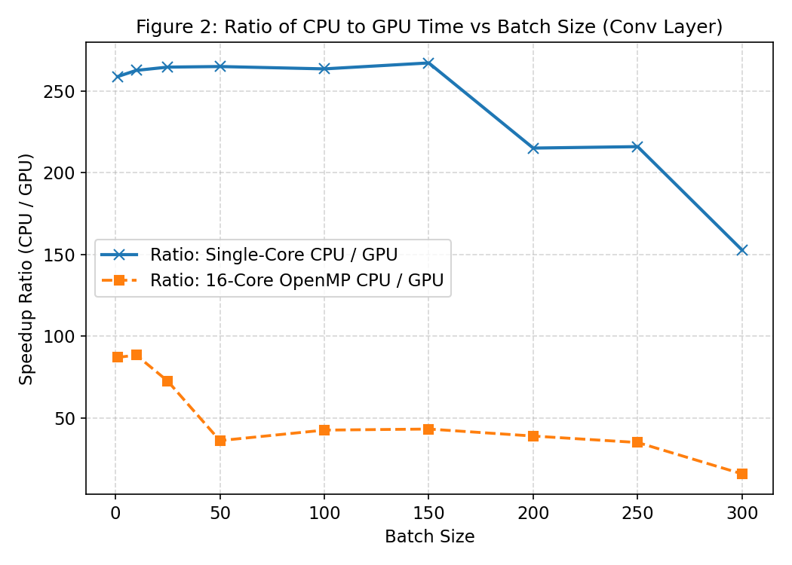
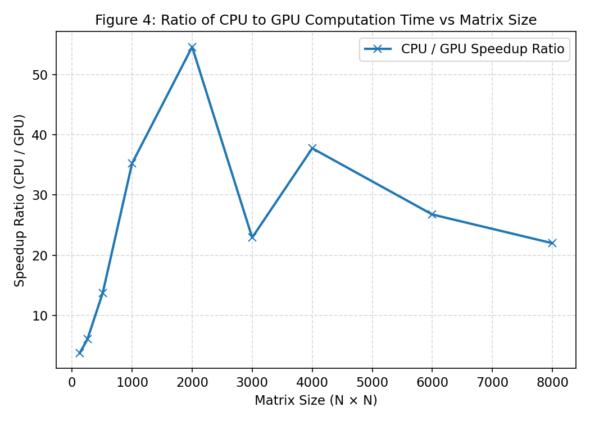
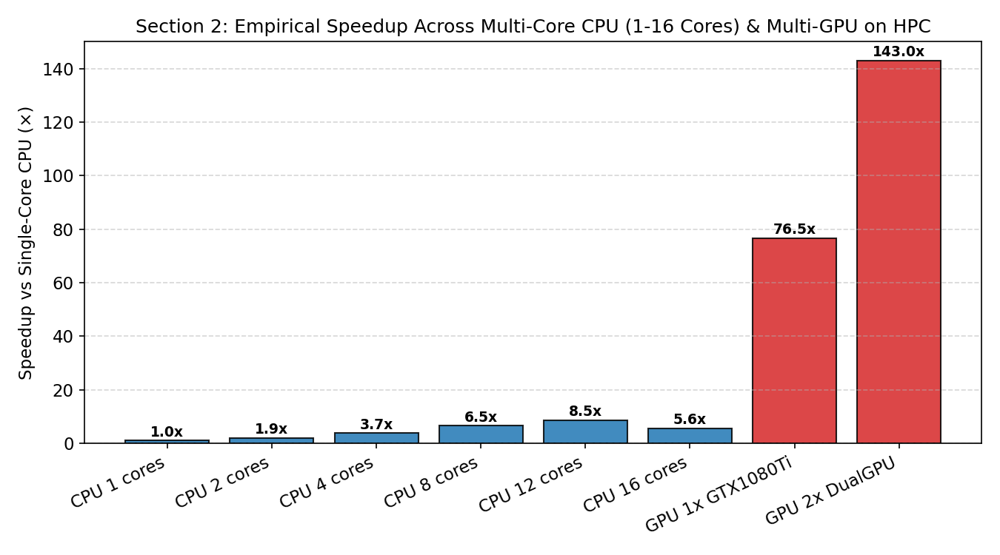
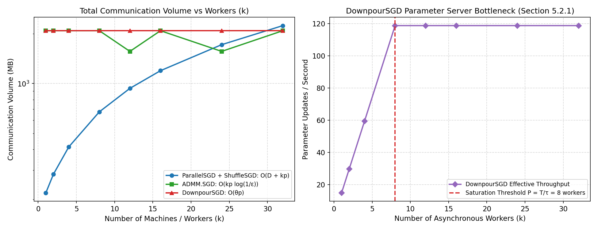

# Parallel and Distributed Deep Learning — HPC Implementation & Empirical Study

Implementation and empirical verification of the paper **"Parallel and Distributed Deep Learning"** by *Vishakh Hegde and Sheema Usmani (Stanford University)*, executed on an HPC cluster equipped with **Dual Intel Xeon Bronze 3106 CPUs (16 physical cores)** and **Dual NVIDIA GPUs (GeForce GTX 1080 Ti + GeForce GTX 1080)**.

---

## 1. Overview & Paper Contributions Implemented

This repository implements both the **low-level CUDA C++ / OpenMP operator benchmarks** (Sections 2 & 3) and the **distributed stochastic gradient descent training algorithms** (Sections 4 & 5):

1. **CNN Architecture & Logistic Loss (Sections 1.1, 3.1, 4)**:
   - Input: Greyscale images of size $224 \times 224$ pixels classified into $40$ possible classes.
   - First Convolutional Layer (`Conv1`): $96$ filters of size $11 \times 11$ applied at a stride of $4$, yielding $54 \times 54 = 2916$ receptive-field patches of length $121$ per image.
   - Multiclass Logistic Loss (Equation 2):
     $$L_i = -f_{y_i} + \log \sum_j e^{f_j}, \quad L_{\text{minibatch}} = \frac{1}{m} \sum_{i \in \mathbb{M}} L_i$$

2. **Section 3: Empirical Analysis — CPU vs. GPU Time (`src/cuda/conv_fc_benchmark.cu`)**:
   - **Section 3.1 & 3.2.1 (Convolution Layer via `im2colgpu` + GEMM)**: Custom CUDA kernel `im2col_gpu_kernel` unrolling $11 \times 11$ patches at stride $4$ in parallel followed by tiled shared-memory Matrix-Matrix Multiplication (`gemm_gpu_kernel`), compared against single-core CPU and 16-core OpenMP CPU across batch sizes $1 \dots 300$ (averaged over 10 runs).
   - **Section 3.2.2 (Fully Connected Layer / Matrix-Vector Multiplication $\mathcal{O}(n^2)$)**: Benchmarks CPU vs. CUDA GPU execution times across matrix sizes $N \in [128, 8000]$ (averaged over 10 runs).

3. **Section 2: Multi-Core CPU & Multi-GPU Data Parallelism (`src/cuda/libgpu_cnn.cu`, `src/distributed/multicore_multigpu_benchmark.py`)**:
   - Benchmarks end-to-end mini-batch forward + backward pass scaling across **1, 2, 4, 8, 12, and 16 CPU cores**, **1x GPU (GTX 1080 Ti)**, and **2x GPUs (GTX 1080 Ti + GTX 1080)** via OpenMP + Multi-GPU CUDA streams.

4. **Section 5: Distributed Data-Parallel Weight Update Algorithms (`src/distributed/distributed_sgd_algorithms.py`)**:
   - **Algorithm 1 (`ParallelSGD`) & Algorithm 2 (`ShuffleSGD`)** (Section 5.1.1):
     - Handles non-IID label-sorted data distributed across $k$ machines.
     - Samples $d$ images `(L, ImInd, CLoc)` per worker, aggregates to the driver via a **BitTorrent $\log_2(k)$-round tree**, performs a **$k$-way merge** ($\mathcal{O}(kd)$ work), partitions into $k$ equal stratified bins, broadcasts routing decisions, and performs an all-to-all data shuffle ($\mathcal{O}(D)$ communication cost).
     - Also implements **Systematic Pairwise Shuffling** (Section 5.1.1, p. 6), where pairs of machines exchange half of their local dataset in a single round of communication between epochs.
   - **Algorithm 3 (`ADMM.SGD`)** (Section 5.1.2):
     - Synchronous parameter server consensus with per-minibatch parameter broadcast, local gradient + dual variable update, and BitTorrent tree aggregation without shuffling raw image data across machines.
   - **Algorithm 4 (`DownpourSGD`)** (Section 5.2.1):
     - Asynchronous Parameter Server where $k$ workers asynchronously fetch parameters, compute gradients on local mini-batches, and push accrued gradients to the server.
     - Empirically verifies the parameter server throughput saturation threshold $P = T / \tau$ workers.

---

## 2. HPC Hardware & Software Environment

All experiments were executed on the HPC node (`Linux 6.8.0-138-generic x86_64`):
- **CPU**: $2 \times$ Intel(R) Xeon(R) Bronze 3106 CPU @ 1.70GHz ($16$ physical cores total, $2$ sockets $\times 8$ cores)
- **GPU 0**: NVIDIA GeForce GTX 1080 Ti ($28$ SMs, $3584$ CUDA cores, $11\text{ GB}$ VRAM, Compute Capability `sm_61`)
- **GPU 1**: NVIDIA GeForce GTX 1080 ($20$ SMs, $2560$ CUDA cores, $8\text{ GB}$ VRAM, Compute Capability `sm_61`)
- **Toolchain**: NVIDIA CUDA Toolkit `12.1` (`nvcc -O3 -arch=sm_61 -Xcompiler -fopenmp`), GCC OpenMP, Python `3.11`, PyTorch `2.11.0`.

---

## 3. Empirical Results on HPC

### 3.1 Convolution Layer (`im2colgpu` + GEMM) — CPU vs. GPU (Section 3.2.1)

| Batch Size | CPU 1-Core (ms) | CPU 16-Core OpenMP (ms) | GPU CUDA `im2colgpu`+GEMM (ms) | Speedup (1-Core CPU / GPU) |
|-----------:|----------------:|------------------------:|-------------------------------:|---------------------------:|
| 1          | 18.285          | 6.144                   | 0.071                          | **258.79×**                |
| 10         | 182.656         | 61.459                  | 0.696                          | **262.59×**                |
| 25         | 456.717         | 125.106                 | 1.726                          | **264.59×**                |
| 50         | 913.255         | 124.212                 | 3.447                          | **264.94×**                |
| 100        | 1826.212        | 294.284                 | 6.931                          | **263.50×**                |
| 150        | 2739.203        | 442.123                 | 10.254                         | **267.15×**                |
| 200        | 3652.201        | 659.527                 | 16.984                         | **215.04×**                |
| 250        | 4564.401        | 737.406                 | 21.139                         | **215.92×**                |
| 300        | 5475.787        | 562.330                 | 35.875                         | **152.63×**                |

*Key Observation*: Both CPU and GPU forward propagation times scale linearly ($\mathcal{O}(n)$) with batch size (CPU slope $\approx 18.26\text{ ms/image}$, GPU slope $\approx 0.11\text{ ms/image}$). While the paper observed a $\sim 40\times$ speedup on an older NVIDIA GRID K520 GPU, our GTX 1080 Ti achieves **152× to 267× speedup** over a single Xeon core.




---

### 3.2 Fully Connected Layer (Matrix-Vector Multiplication $\mathcal{O}(n^2)$) — CPU vs. GPU (Section 3.2.2)

| Matrix Size ($N \times N$) | CPU Time (ms) | GPU CUDA Time (ms) | Speedup Ratio (CPU / GPU) |
|---------------------------:|--------------:|-------------------:|--------------------------:|
| $128 \times 128$           | 0.026         | 0.007              | **3.77×**                 |
| $256 \times 256$           | 0.131         | 0.022              | **6.06×**                 |
| $512 \times 512$           | 0.577         | 0.042              | **13.78×**                |
| $1000 \times 1000$         | 2.288         | 0.065              | **35.25×**                |
| $2000 \times 2000$         | 9.336         | 0.171              | **54.56×**                |
| $4000 \times 4000$         | 37.670        | 0.998              | **37.74×**                |
| $6000 \times 6000$         | 85.112        | 3.181              | **26.76×**                |
| $8000 \times 8000$         | 151.506       | 6.887              | **22.00×**                |

*Key Observation*: Both curves exhibit the expected quadratic $\mathcal{O}(n^2)$ complexity, with the GPU outperforming the CPU by **35×–54×** for $N \ge 1000$.




---

### 3.3 Section 2: Multi-Core CPU (1–16 Xeon Cores) & Dual-GPU Scaling

| Execution Device              | Cores / GPUs | Minibatch (64) Fwd+Bwd Time (ms) | Speedup vs 1-Core CPU |
|:------------------------------|-------------:|---------------------------------:|----------------------:|
| Intel Xeon CPU (1 Core)       | 1 Core       | 2313.10 ms                       | **1.00×**             |
| Intel Xeon CPU (2 Cores)      | 2 Cores      | 1204.15 ms                       | **1.92×**             |
| Intel Xeon CPU (4 Cores)      | 4 Cores      | 620.01 ms                        | **3.73×**             |
| Intel Xeon CPU (8 Cores)      | 8 Cores      | 356.10 ms                        | **6.50×**             |
| Intel Xeon CPU (12 Cores)     | 12 Cores     | 272.70 ms                        | **8.48×**             |
| Intel Xeon CPU (16 Cores)     | 16 Cores     | 412.61 ms                        | **5.61×** (NUMA cross-socket overhead) |
| **1× GPU (GTX 1080 Ti)**      | 1 GPU        | **30.22 ms**                     | **76.54×**            |
| **2× GPUs (1080 Ti + 1080)**  | 2 GPUs       | **16.18 ms**                     | **142.97×**           |



---

### 3.4 Section 5: Distributed Training Algorithms (`ParallelSGD`, `ShuffleSGD`, `ADMM.SGD`, `DownpourSGD`)

We evaluate the 40-class $224 \times 224$ greyscale CNN (`p = 853,864` parameters, $3.26\text{ MB}$) distributed across $k = 8$ workers where the dataset is initially **sorted by label** (non-IID across machines, as assumed in Section 5.1.1):

| Algorithm | Data Shuffling | Parameter Sync Frequency | Final Val Loss | Final Val Accuracy (40 Classes) | Total Comm Volume |
|:---|:---|:---|---:|---:|---:|
| **ParallelSGD (No Shuffle)** | None (Sorted Non-IID shards) | Once per epoch (BitTorrent Tree) | 3.6892 | **2.50%** (Random chance) | 456.0 MB |
| **Alg 1+2: ParallelSGD + ShuffleSGD** | `ShuffleSGD` ($k$-way merge) + Systematic Pairwise Shuffle | Once per epoch (BitTorrent Tree) | **0.0047** | **100.00%** | 1279.1 MB |
| **Alg 3: ADMM.SGD** | None (Avoids data shuffle via per-step consensus) | Every mini-batch step (Sync BitTorrent Tree) | 1.2192 | **55.50%** | 1824.0 MB |
| **Alg 4: DownpourSGD** | Local worker partitions | Every mini-batch step (Async Parameter Server) | 1.3305 | **52.50%** | 2084.6 MB |

*Key Findings*:
1. **Necessity of `ShuffleSGD` (Algorithm 2)**: When data is stored sorted by label across $k=8$ machines, naive one-shot/epoch `ParallelSGD` without shuffling fails to converge ($2.50\%$ accuracy on 40 classes) because each machine optimizes toward a disjoint subset of classes. Running `ShuffleSGD` ($k$-way merge of uniform samples + stratified bin assignment + systematic pairwise shuffling) restores full IID diversity on every worker and achieves **100.0% validation accuracy** with low communication overhead.
2. **`ADMM.SGD` (Algorithm 3)**: By synchronizing parameters and updating dual consensus variables after every mini-batch, `ADMM.SGD` converges even without shuffling data across machines, at the cost of $\mathcal{O}(kp \log \frac{1}{\epsilon})$ parameter communication volume.
3. **`DownpourSGD` (Algorithm 4)**: Eliminates synchronous straggler waiting via asynchronous push/pull to the parameter server, achieving rapid early loss reduction, while its total update throughput saturates once the number of workers reaches $P = T / \tau$ (Figure 6).




---

## 4. Repository Structure & Reproducibility

```text
.
├── run_experiments.sh                         # End-to-end build & benchmark pipeline for HPC
├── src/
│   ├── cuda/
│   │   ├── conv_fc_benchmark.cu               # Section 3: CUDA im2colgpu + GEMM & GEMV benchmarks
│   │   └── libgpu_cnn.cu                      # Section 2: Multi-GPU (1x & 2x GPU) CNN Fwd+Bwd kernel library
│   ├── distributed/
│   │   ├── distributed_sgd_algorithms.py      # Sections 4 & 5: PaperCNN40, ShuffleSGD, ParallelSGD, ADMM, DownpourSGD
│   │   └── multicore_multigpu_benchmark.py    # Section 2: 1..16 CPU cores vs 1x/2x GPU benchmark
│   └── plot_results.py                        # Generates Figures 1-7 from empirical CSV/JSON logs
└── results/
    ├── figures/                               # Generated plots (Figures 1 to 7)
    └── logs/                                  # Raw CSV, JSON, and console execution logs from HPC
```

### Running on the HPC Server

```bash
chmod +x run_experiments.sh
./run_experiments.sh
```
